# AI agents and Factory Loops

[Documentation index](../README.md) · Authority for workflow bounds

## One orchestrator, restricted capabilities

“Agents” are roles within one Gemini adapter and deterministic services, not independent autonomous processes.

| Role | MVP responsibility | Permitted output |
|---|---|---|
| Intake/order | Classify owner/customer text and extract order details | Draft order or clarification |
| Ledger | Extract sale/payment intent and exact stated amounts | Financial proposal only |
| Verification | Validate required fields, allowed enums, tenant references | Server accept/reject/clarify; deterministic |
| Follow-up | Evaluate pending order and remind owner | Deterministic workflow event; optional update draft |
| Insights | Phrase verified aggregate totals | Read-only summary; deterministic fallback |
| Inventory/supplier | Future release | No MVP capability |

No model has a tool that directly posts a sale, marks payment received, sends a customer message, changes a subscription, purchases stock, or edits a financial record. Every external customer update needs an owner-approved recipient and final text.

## AI contract

Structured response fields: `schemaVersion`, `intent`, `language`, `customerCandidates`, `items`, `statedTotalPaisa`, `statedReceivedPaisa`, `dueAtCandidate`, `missingFields`, `clarification`, and optional plain-language explanation. Intent is an allowlisted enum: draft_order, draft_sale, draft_payment, query_summary, unknown. Model-provided identifiers are resolved and authorized server-side; they never define the tenant.

Unknown fields, invalid schema, negative amounts, unsupported currency, ambiguous dates/names, inconsistent totals, or incomplete intent produce clarification or a blocked draft. Self-reported model confidence cannot authorize an action. Treat message content as untrusted data, including instructions to ignore rules or reveal other businesses.

Proposed limits: 2,000 characters per incoming text; 4,000 input-token budget including context; 600 output tokens; at most two Gemini calls per logical instruction including one schema-repair or transient retry; 15-second timeout per call. No recursive tool loop or automatic model escalation. If context cannot fit, ask a targeted question. A clarification answer starts a new metered instruction, capped by tenant quotas. Review wording in [billing](BILLING_AND_AI_COSTS.md).

## Proposal lifecycle

`DRAFT -> NEEDS_CLARIFICATION -> DRAFT -> READY -> APPROVED -> EXECUTED` with `REJECTED`, `EXPIRED`, and `FAILED` as alternate outcomes. APPROVED to EXECUTED is atomic with the financial commit; externally visible committed records must never depend on a later worker finishing approval.

Only READY proposals are approvable. Proposals expire 24 hours after the most recent material edit. Each edit increments version and changes payload hash; every old approval becomes invalid. Revalidate current balances and linked order status at execution. Validation failure returns a conflict and requires a new preview, not a quiet payload change. Reply “yes” alone is insufficient; bind WhatsApp interactive approval or explicit command to a proposal and version.

## The only MVP Factory Loop: pending-order follow-up

**Objective:** help the owner resolve a pending order before/around its due date. It is not a debt-collection or payment-verification loop.

Eligibility: approved pending order, explicit due timestamp, owner enables follow-up, active tenant, no existing workflow for that order. At most one workflow lifetime per order in MVP; terminal workflows cannot be automatically restarted. Due-date edits terminate the active workflow as NEEDS_HUMAN for manual follow-up; rearming on the same order is deferred.

`startAt = max(enabledAt, dueAt - 24h)`; `expiresAt = min(startAt + 72h, dueAt + 24h)`. An already expired order cannot start. Deadline never extends on retries, reschedules, delay replies, or worker restarts.

```mermaid
stateDiagram-v2
    [*] --> SCHEDULED
    SCHEDULED --> CHECKING: due timer
    CHECKING --> RESOLVED: order fulfilled
    CHECKING --> CANCELLED: order cancelled or owner stops
    CHECKING --> WAITING_OWNER: pending; reminder permitted
    WAITING_OWNER --> SCHEDULED: second check due
    WAITING_OWNER --> RESOLVED: owner fulfills order
    WAITING_OWNER --> CANCELLED: owner cancels
    CHECKING --> NEEDS_HUMAN: bounds or policy/config failure
    SCHEDULED --> EXPIRED: deadline reached
    WAITING_OWNER --> EXPIRED: deadline reached
    CHECKING --> EXPIRED: deadline reached
    CHECKING --> FAILED: technical retries exhausted
```

WAITING_OWNER may hold an optional customer-update proposal. It is not a separate autonomous loop. A customer reply is an event for owner review; it cannot resolve fulfillment by itself.

Implemented S6 behavior: configured lower counter/lifetime caps are snapshotted on enablement, and configured reminder spacing is snapshotted at no less than 12 hours. Checks wait for actual reminder dispatch before scheduling the next check. A blocked channel creates dashboard-only handling and NEEDS_HUMAN instead of another automation. Any order that has entered this lifetime keeps its single workflow association for customer updates; a terminal/exhausted workflow cannot be bypassed by creating another general update for that order. A separately approved message for an order that never entered a workflow remains a manual action. Owner WhatsApp stop command: `STOP WORKFLOW <workflow-id>`; plain STOP remains messaging opt-out.

## Hard limits and scheduling

| Control | MVP limit |
|---|---|
| Business checks | Maximum 3 logical checks total, including initial check |
| Owner reminders | Maximum 2 logical reminders; at least 12 hours apart |
| Customer updates | Maximum 1 logical message per workflow, separately approved |
| Workflow lifetime | Above expiresAt formula; maximum 72 hours |
| Technical retries | Per logical job: initial attempt plus at most 2 retries, at 1 and 5 minutes |
| AI calls in scheduled checks | Zero; customer update can use deterministic editable wording |
| Quiet hours | No proactive WhatsApp messages 21:00–09:00 Asia/Karachi |
| Approval timeout | Proposal 24 hours; never beyond workflow expiry for workflow messages |

First check at startAt. Schedule the second check no earlier than first reminder +12h; after second reminder schedule one final status check 12h later if before expiresAt. If quiet hours defer a send to 09:00, recheck state/consent/deadline then and anchor the next spacing to actual dispatch. If dispatch is prohibited, show the reminder in the dashboard; if it cannot be sent before expiry, do not send late. No polling while waiting beyond these scheduled checks and the expiry timer.

Technical retries reuse the same logical action key and do not create new reminders/checks. Persist attempt and check counters before side effects. Terminal check, order state, stop flag, quota, and deadline are revalidated at each attempt. Missing consent, paused templates, invalid credentials, or unresolved delivery uncertainty lead to dashboard-only handling/NEEDS_HUMAN, not endless retries.

## Stop and safety rules

Owner can stop from dashboard or explicit WhatsApp command bound to the workflow. Fulfillment, cancellation, opt-out, tenant suspension, due-date change, expiry, or exhausted bounds stops pending sends and cancels jobs. An approval already queued must be rechecked immediately before send. At deadline create an EXPIRED audit event and manual inbox item; no additional WhatsApp escalation.

All customer messaging checks recipient opt-in and current Meta policy at dispatch. Customer opt-out cancels unsent customer messages immediately. An in-flight provider request may not be retractable; retain the event and show its actual status. A send timeout with uncertain acceptance is never automatically resent. [API](API_AND_WHATSAPP.md) owns delivery handling and [testing](TESTING_AND_ACCEPTANCE.md) owns proof of boundedness.

## Assistant date normalization — 1 November 2026

The owner requested natural written dates/times and next-month-first defaults. Deterministic source-text parsing owns dates; the model is instructed to return a null date candidate. Date-only inputs use 09:00 Asia/Karachi, absent dates use next month first at 09:00, and explicit times are preserved. Invalid, conflicting or incomplete dates clarify. Order deadlines and credit-sale repayment dates are visible in the exact owner-approved proposal. A repayment date does not convert a credit sale into an order and does not create a second scheduled workflow. Existing pending-order loop counters, quiet hours and expiry rules are unchanged.

## Free web hosting profile — 1 November 2026

The owner's zero-spend deployment profile sets FOLLOW_UP_ENABLED=false. The authenticated enable endpoint rejects new workflows and the order view hides its enable button. Manual order updates and stopping existing workflows remain available. No scheduling counters, approvals, expiry rules or financial effects change; a durable worker is still required before this feature can be enabled on a future host. Existing active workflows must be reviewed before migrating data into this profile. See [free deployment](FREE_DEPLOYMENT.md).
