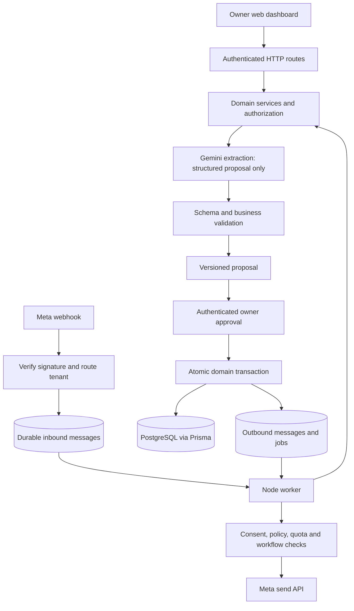

# Architecture

[Documentation index](../README.md) · Proposed modular monolith

## Stack and deployment boundary

| Layer | Choice | Status |
|---|---|---|
| Dashboard | Next.js, TypeScript, responsive UI; Tailwind CSS proposed | Required framework; styling pending review |
| HTTP/backend | Node.js/TypeScript; Next.js server routes with domain services | Same codebase, server-only secrets |
| Durable worker | Separate Node.js process from the same source tree | PostgreSQL-backed jobs/outbox; no Redis required initially |
| Data | PostgreSQL and Prisma | Transactional source of truth |
| Identity | Managed authentication; Firebase Auth proposed | Provider decision Q3; browser ID token verified on server |
| AI | Gemini Developer API using API key associated with AI Studio project | Not Vertex AI; credit eligibility pending |
| Messaging | Meta WhatsApp Cloud API | Dedicated recipient number per tenant |
| Hosting | Container-capable web and continuously running worker; Cloud Run is a candidate | Hosting/database region and cost pending Q4 |
| Operations | Structured redacted logs, error alerts, backups, usage metrics | Vendor choice later |

Do not assume a serverless HTTP instance continues running jobs after a response. The worker needs a supported always-running deployment or a reliable externally scheduled invocation. If Cloud Run is chosen, explicitly choose its worker execution/billing model; do not rely on background work in request-only CPU time.

No object storage is needed for MVP text input. Media storage and any retention settings for audio/receipts are V1.1 decisions. Pin supported Node.js, Next.js, Prisma, SDK, and model versions during S1/S4, after checking their official documentation; this plan does not prescribe stale versions.

## Modules and authority

- Identity/tenancy resolves the actor and tenant on every request and job.
- Contacts owns customer/supplier data and normalization.
- Proposals owns validated draft payloads, versions, expiration, and approval evidence.
- Orders owns commitments/status/due dates; ledger owns sales/payments/allocations/reversals.
- Messaging owns webhook ingress, conversations, delivery events, consent, and outbox.
- Workflow engine owns the single bounded pending-order loop and durable timers.
- AI adapter accepts minimum context and returns schema-validated data, never database credentials or unrestricted tools.
- Usage service reserves quota, records provider consumption, and reconciles reservations.

All channels invoke the same domain functions. Never implement money calculations separately inside a prompt, route handler, or WhatsApp adapter.

## Inbound to approval

Verify the raw webhook signature before parsing or trusting identifiers. Resolve tenant using the configured recipient phone-number ID. Persist individual messages with unique provider identifiers and enqueue processing in one transaction; acknowledge only after durable acceptance. Status callbacks use their own deduplication identity. A duplicate gets a successful acknowledgement without creating another job.

Worker resolves sender authority, reserves AI budget, calls Gemini, validates output, and persists a proposal or clarification. AI never approves. Owner approval locks the proposal and relevant ledger rows, verifies version/hash/expiry and current balances, then writes business records, approval event, and outbox intents in one transaction. Send success is not required for a successful database commit; show delivery separately.

## Concurrency and recovery

Use transactional row claims (for example PostgreSQL `FOR UPDATE SKIP LOCKED`) with leases and unique job execution keys. A crashed lease can be reclaimed. Every handler checks terminal state and expiry after reclaim. Use an outbox unique action key so replay cannot enqueue a second logical notification. See [API](API_AND_WHATSAPP.md) for the unavoidable uncertain-send case; no claim of end-to-end exactly-once WhatsApp delivery.

For financial writes, lock affected sale/allocation rows in stable order, revalidate balances, and serialize competing approvals. Prisma migrations must include the database constraints described in [schema](DATABASE_SCHEMA.md), using reviewed SQL where ORM declarations are insufficient.

## Failure behavior and observability

Gemini unavailable: retain draft, offer manual form; no automatic fallback to a more expensive model. Meta unavailable: retain inbox/outbox status, allow web use. Database unavailable: reject new mutations; do not acknowledge unpersisted incoming work as accepted. Worker unavailable: overdue work resumes only if still within workflow bounds.

Track correlation IDs, tenant IDs, job/proposal IDs, latency, retry reason, queue age, signature failures, spend, and delivery state without full message bodies in logs. Alert on growing queue age, repeated failures, usage cap, backup failures, and cross-tenant authorization anomalies. Restore procedure and evidence are required before pilot.

## Free web deployment profile

[Netlify Free + Neon Free](FREE_DEPLOYMENT.md) is the prepared zero-spend deployment path, retaining Firebase Auth and the existing Gemini adapter. It runs the Next.js web/API through Netlify's automatic adapter. It does not provision the separate worker, hosted backups or maintenance schedule. FOLLOW_UP_ENABLED=false prevents starting unscheduled follow-up work; manual finance remains independent. Production Firebase credentials can use matching server-only service-account JSON on non-Google hosts or ADC where supported. Runtime pools use two connections per instance with idle expiry; migrations may use a separate direct URL. Provider adapter build, real hosted authentication, pool/TLS connectivity and cloud smoke tests are NOT RUN until accounts/site settings are connected.
